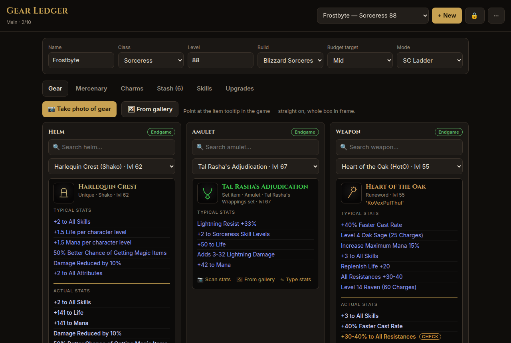
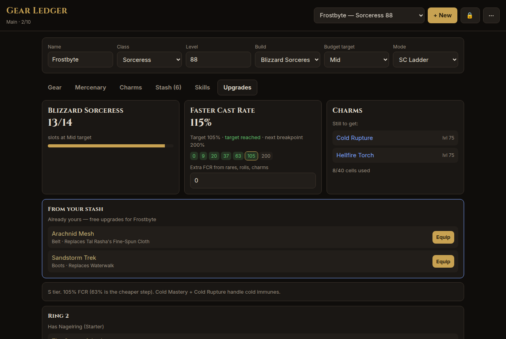
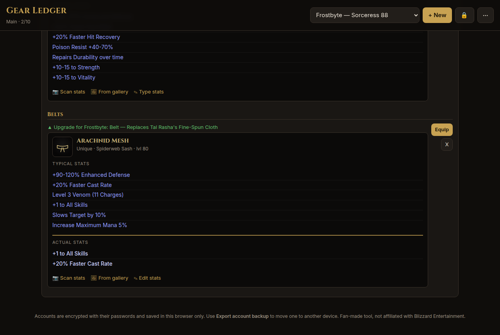
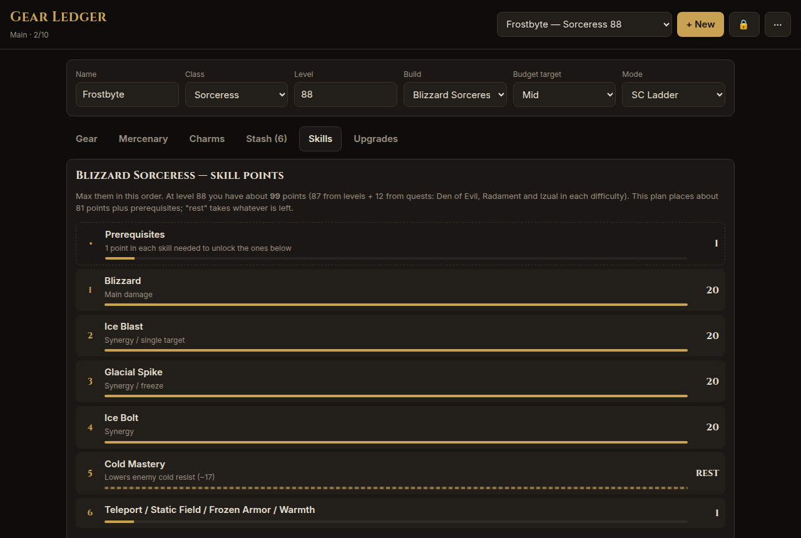
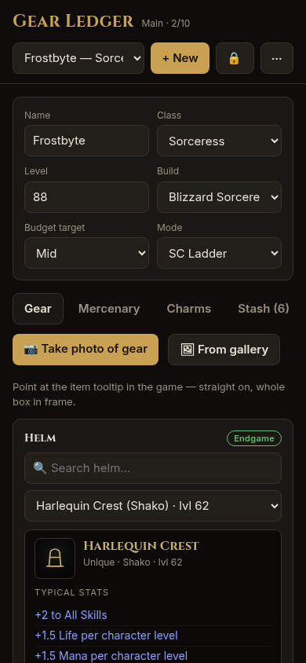

# Perfect Roll — D2R gear tracker

Track Diablo II: Resurrected characters' equipped gear, mercenary, and charm inventory, and get upgrade recommendations by build and budget (Starter / Mid / Endgame).

**Live site:** https://jlyle.github.io/D2r-gear/

## Features
- Password-protected accounts, each with up to 10 characters and its own shared stash. Data is encrypted (AES-GCM, PBKDF2 key) and stored in the browser only; a forgotten password can't be recovered.
- Export an encrypted backup of a whole account (all characters, gear, stats and stash) and restore it on any device. See **Back up and restore your data** below.
- Slot-by-slot gear picker with uniques, sets, runewords and common rare/crafted types, plus item search (name, nickname or rune recipe)
- Mercenary weapon, helm and armor
- Charm inventory with 10×4 cell usage and duplicate-unique warnings
- Shared stash (all characters): any item — gear, runes, gems, jewels, keys, organs, essences, tokens, or your own custom items; flags stash items that upgrade the current character, one-tap Equip that swaps the worn item back to stash
- Top 5 builds for every class, including the Warlock (Season 15 / Patch 3.3, Reign of the Warlock), with Starter/Mid/Endgame gear per slot
- Add gear from photos: snap item tooltips, on-device OCR (Tesseract.js) matches the item, pre-picks the slot and fills in your rolls
- Photos are only used to read stats and are never stored; items show original gear-type icons tinted by rarity
- Tooltip-style item display: typical stats, a divider, then the item's actual stats; per-item Scan stats from a photo
- Runewords tab: what you can make from the runes in your stash, what you're one or two runes away from, and Traderie links for the missing ones
- Gems & Cube tab: gem inventory by grade, Horadric Cube rune and gem upgrades you can do right now
- Skills tab: suggested skill point order and amounts plus stat points for all 40 builds
- Upgrades tab: stash upgrades first, then per-slot suggestions with Traderie links, FCR breakpoint check for caster builds, missing charms
- Terror Zones tab: current and next zone for single player (worked out on your device) and online (player reports via D2RuneWizard), each rated for your character's build, sunder charms and Infinity merc

## Recording your item's actual stats
Every item you own — worn, on the merc, in the charm inventory or in the shared stash — shows two blocks: **Typical stats** (what the item can roll, from the game data) and **Actual stats** (the rolls on *your* copy). Actual stats are optional, but they're what tells a 15% Enigma from a perfect one when you're comparing or trading.

There are three ways to fill them in, all under the item's tooltip:
- **📷 Scan stats** — take a photo of the in-game tooltip. The text is read on your device and the photo is thrown away. For known uniques, sets and runewords the reader matches against that item's own stat lines, so OCR slips get corrected; for magic charms and jewels it uses the affix name (e.g. "Cobalt Small Charm of Vita") to know which stats to look for.
- **🖼 From gallery** — same thing from a screenshot you already have.
- **✎ Type stats / Edit stats** — one stat per line, e.g. `+35% Faster Cast Rate`. Use this to fix anything the scan got wrong.

Good to know:
- A line marked **check** is one the scan couldn't read. Tap Edit stats and enter your roll.
- Scanning again asks before replacing stats you already have.
- Stats stay with the item: **Equip** from the stash carries them onto the character, and the item it replaces goes back to the stash with its own stats intact.
- Picking a *different* item in a slot clears that slot's stats, since the old rolls no longer apply.
- Custom items added on the Stash tab take an optional stats box when you create them.
- **Find in your stash** searches actual stats too, so you can look up "faster cast" or "all resist" across everything you own.
- Upgrade suggestions are ranked by item and build tier, not by your exact rolls — actual stats are for your own comparison.

## Runes
Runes live in the shared stash like any other item, so every character on the account sees the same pile.

**Adding runes:** on the Stash tab, choose Gear type **Rune** and pick from El through Zod. Runes stack: adding one you already have bumps its count instead of making a new row, and the − / + buttons on the row change the count directly.

**Runewords tab** — built from the runes in your stash:
- **Runes in your stash** — every rune you hold, in game order, with counts.
- **Ready to make** — runewords you have every rune for, with how many you can make. Ones used by your current build are starred and listed first.
- **Almost there** — runewords missing one or two runes where you already own at least half the recipe. Each missing rune links to a Traderie search.
- Each card shows the rune order, allowed bases, required level, and the runeword's stats.
- Filter to **All runewords** or **Only** your current build's.

**Gems & Cube tab** — Horadric Cube upgrades from your stash:
- **Rune upgrades you can cube now** — El through Ort take 3 runes; Thul through Lem take 3 runes plus a gem; Pul and up take 2 runes plus a gem. The required gem follows the game's recipe table (Topaz, Amethyst, Sapphire, Ruby, Emerald, Diamond, stepping up a grade every six runes).
- **Missing only the gem** — recipes where you have the runes but not the gem, with a note when you could cube that gem from three of the grade below.
- **Gem upgrades** — any three gems of the same type and grade that make one of the next grade.
- **All rune recipes** — a collapsible reference of the full El → Zod chain.

Each recipe is counted on its own, so two recipes that need the same gem can both show as available — cube one and the other updates.

## Terror Zones
The **Terror Zones** tab shows what's terrorized now and next, and how well the current character can handle it.

**Single player** works on its own: the app runs the game's offline rotation (the same 30-minute schedule the game uses, verified against published schedules), so it needs no server or token. It shows the current zone with a countdown, the next zone, and the rest of the day under **Later today**. In the game, turn on **Enable Terror Zones** in the offline game settings; a difficulty unlocks once you've killed Baal on it.

**Online (Battle.net)** zones can't be predicted, so they come from what players report to [D2RuneWizard](https://d2runewizard.com/terror-zone-tracker). To turn it on:
- **Step 1:** On the Terror Zones tab, enter a contact email (D2RuneWizard's API asks for one) and tap **Turn on online zones**.
- **Step 2 (if needed):** If D2RuneWizard gave you an API token, paste it in too. Their [integration page](https://d2runewizard.com/integration) doesn't say how to get one; ask on their Discord or with the form on that page.

The email and token are stored encrypted in your account and only sent to D2RuneWizard.

The next online zone isn't published ahead of time, so the card shows a countdown to the switch and picks up the new zone once players report it.

**Ratings** compare each zone's Hell monster types with your build's damage type:
- **Clear it all** — nothing there is immune to you. **Mostly fine** — at least 85% of monster types. **Tough** — more than that are immune.
- A sunder charm in your charm inventory (Cold Rupture, Flame Rift, Crack of the Heavens, Rotting Fissure, Bone Break, Black Cleft) counts as breaking that immunity, and **Infinity** on your mercenary breaks fire, cold and lightning immunities under 117%.
- When a missing sunder charm would help, the zone says how many monster types it would open up, with a Traderie link.
- Champions and uniques can roll extra immunities, so treat the rating as a guide.

The zone list and immunities come from the game's own data files; `tools/gen_terrorzones.py` regenerates them after a patch.

## Back up and restore your data
**⚠️ Your characters exist only in this browser on this device.** Nothing is sent to a server, so there's no cloud copy and no account recovery. If you clear your browser data, uninstall the browser, use a private window, switch phones, or forget your password, the data is gone unless you have a backup. **Export a backup regularly**, and always before you clear site data or change devices.

### What a backup contains
- One file covers **one whole account**: all its characters (up to 10), each character's gear, mercenary, charms, build and actual stats, plus the account's shared stash and custom items.
- It does **not** contain any photos, because photos are never kept.
- The file stays **encrypted** with the account's password (AES-GCM, PBKDF2-SHA-256 key). It's safe to keep in cloud storage or email to yourself, but without the password nobody can open it, including you.
- If you have several accounts (e.g. Ladder and Hardcore), export each one separately.

### Exporting
- **Step 1:** Unlock the account.
- **Step 2:** Open the **⋯** menu and tap **Export account backup**.
- **Step 3:** You get a file named like `perfect-roll-Ladder-2026-10-21.json`. In a browser it downloads (on Android phones, to the Downloads folder). In the **Android app**, a "Save or send your backup" sheet opens instead: pick Google Drive, Gmail, Files or any app to save it.
- **Step 4:** Keep it somewhere off the device: Google Drive, OneDrive, email, a USB stick. Its name includes the date, so you can keep several and know which is newest.

### Restoring
- **On a new device or after clearing data:** open the site. On the sign-in screen, use **Restore → Import account backup**, pick the `.json` file, then unlock it with its password.
- **While you're signed in:** open **⋯ → Import backup**. The current account locks, and the restored one appears in the account list.
- A restore **adds a new account**. It never overwrites an existing one. If the name is already taken, the restored copy is named, for example, `Ladder (2)`. You can check it, then delete whichever copy you don't need.
- Older single-list backups from before accounts existed are **merged** into the account you have unlocked. Characters and stash items already there are skipped, and only as many characters as fit under the 10-character limit are added.

### Things that catch people out
- **Passwords are tied to the backup.** A backup opens with the password the account had *when you exported it*. If you use **Change password**, older backups still need the old password, so export a fresh backup right after changing it.
- **Deleting is permanent.** **Delete account** and **Delete character** can't be undone. Export first if there's any doubt.
- **Each browser keeps its own data.** Chrome and Firefox on the same computer, or the website and an installed app, don't share data. Use export and restore to move between them.
- **Storage full or blocked.** If the site says it couldn't save, export immediately so you don't lose what's on screen.

## Screenshots
**Upgrades:** stash items that beat what you're wearing come first, then the FCR breakpoint check and charms still to get.

**Stash:** items shared by all your characters, with upgrades for the current one flagged and one-tap Equip.

**Skills:** skill point order and amounts for the selected build.

**On a phone:** the whole app works at phone width, including photo import.

## Editing data
Curated items and build guides live in `data.js`. `catalog.js` adds every other D2R unique, set item and runeword; it's generated by `tools/gen_catalog.js` from [blizzhackers/d2data](https://github.com/blizzhackers/d2data) (MIT): `node tools/gen_catalog.js <path-to-d2data> catalog.js`.

In `data.js`: Add an item to `ITEMS`, then reference its exact name in a build's tier lists (`[starter, mid, endgame]`).

Fan-made; not affiliated with Blizzard Entertainment.
